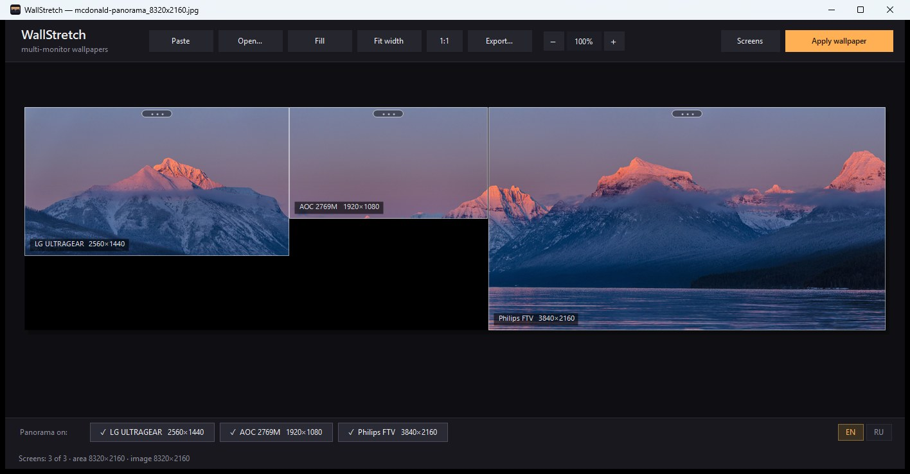

# WallStretch

**English** · [Русский](README.ru.md)

Multi-monitor wallpaper composer for Windows: arrange, scale and align one image across several
screens, see exactly how it lands on each monitor, and apply it with one click.

Windows 10/11 · .NET Framework 4.x · MIT



## Features

- **Live preview** of the real desktop: monitors in their true proportions and positions.
- **Paste a picture** from the clipboard (`Ctrl+V`), open a file, or drag & drop it into the window.
- **Zoom**: mouse wheel (around the cursor), `−` / `+` buttons, click the percentage to reset to 1:1.
- **Move the image** with the mouse or arrow keys (`Shift` = 10 px).
- **Move a monitor up/down** with the `⋯` grip at the top of the screen — so the picture matches the
  real physical height of your monitors. Double-click the grip to reset.
- **Exclude monitors** from the panorama: excluded screens are left untouched, the workspace shrinks
  to the remaining ones.
- **Wallpapers per monitor** (`IDesktopWallpaper`): pixel-exact, no stretching, works with mixed DPI
  (tested on a 4K TV at 300 % scaling).
- **Export** per-monitor images to a folder.
- **Interface: English / Russian** (English by default) — switch with `EN` / `RU` at the bottom right.
- The selected screens, offsets and language are remembered between runs.

## Install

1. Download `WallStretch-1.x.zip` from [Releases](https://github.com/nikkawaf-rgb/WallStretch/releases) and unpack it.
2. Run `WallStretch.exe`.

Requires Windows 10/11 with .NET Framework 4.x (already included in Windows).

## Usage

1. Add a picture (`Ctrl+V`, “Paste”, “Open…”, or drag & drop).
2. The preview shows your desktop: monitor frames over the image.
3. Drag the image, zoom with the wheel, use **Fill** / **Fit width** / **1:1** for quick presets.
4. If a screen sits lower or higher than its frame, drag its `⋯` grip up/down until the picture lines up.
5. Press **Apply wallpaper** — each included monitor gets its own pixel-exact image.

## Keyboard shortcuts

| Keys | Action |
| --- | --- |
| `Ctrl+V` | paste an image from the clipboard |
| `Ctrl+O` | open a file |
| `Ctrl+S` | export per-monitor images to a folder |
| arrows | move the image by 1 px |
| `Shift` + arrows | move the image by 10 px |
| mouse wheel | zoom the image |
| double-click the image | “Fill” |
| double-click a monitor grip | reset that screen's vertical offset |

## How it works

- For every monitor an image of exactly its physical size is rendered (e.g. 2560×1440) with the
  required part of the picture, taking that screen's vertical offset into account.
- The images are applied through `IDesktopWallpaper.SetWallpaper`, so Windows draws them 1:1 in
  physical pixels — no stretching, no cropping.
- Dragging a screen down by 60 px shifts the picture on it up by exactly 60 px (verified with
  screenshots).

## Command line

```
WallStretch.exe --list                          list monitors
WallStretch.exe --render in.jpg out.jpg         render the whole desktop without opening the window
WallStretch.exe --apply in.jpg                  stretch across the whole desktop (Span)
```

## Build

```
powershell -ExecutionPolicy Bypass -File build.ps1
```

Uses `csc.exe` from .NET Framework 4.x — no NuGet, no external dependencies. Every `v*` tag is built
and published automatically by GitHub Actions (`.github/workflows/build.yml`).

## License

MIT — see [LICENSE](LICENSE).
