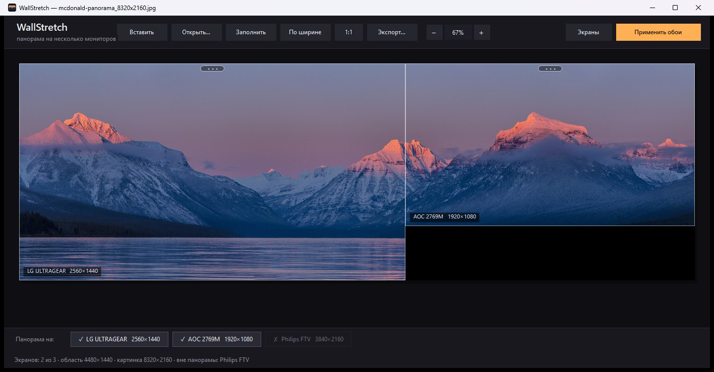
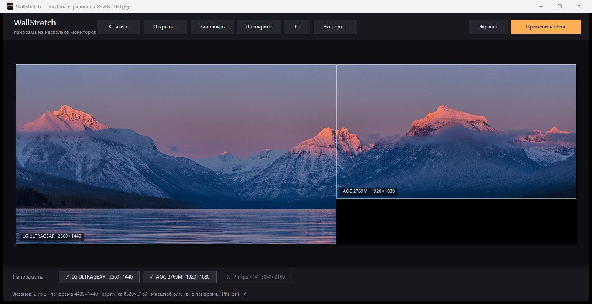

# WallStretch

Приложение для Windows: раскладывает одну картинку по нескольким мониторам, показывает,
как она реально ляжет на каждый экран, и даёт двигать/масштабировать картинку и подгонять
положение каждого монитора. Обои ставятся на каждый экран отдельно — попиксельно, без растягивания.

Windows 10/11 · .NET Framework 4.x · MIT



## Запуск

`WallStretch.exe` — можно закрепить на панели задач или положить ярлык на рабочий стол.

Требования: Windows 10/11, .NET Framework 4.x (есть в системе по умолчанию).

## Как пользоваться

1. **Добавить картинку** — `Ctrl+V` из буфера, кнопка «Вставить», «Открыть…» или перетащите файл в окно.
2. В центре — **рабочий стол**: прямоугольники мониторов в их реальных пропорциях и положении.
3. **Двигать картинку** — тянуть мышью. **Масштаб** — колесо мыши (зумит вокруг курсора) или кнопки
   `−` / `+` в панели; в окошке между ними показан текущий масштаб, клик по нему — вернуть 1:1.
4. **Сдвинуть монитор по вертикали** — потяните за «ручку» `⋯` сверху экрана. Так картинка
   подгоняется под реальное расположение мониторов (например, если AOC стоит ниже LG).
   Двойной клик по ручке — сброс сдвига в ноль. Сдвиг виден в подписи экрана (`+40`).
5. Быстрые режимы: **Заполнить** (двойной клик), **По ширине**, **1:1**.
6. **Применить обои** — для каждого включённого монитора собирается своя картинка точно в его
   разрешении и ставится через системный API (IDesktopWallpaper). Исключённые мониторы не трогаются.

## Исключение мониторов

Внизу окна — строка **«Панорама на:»** с кнопками-экранами. Клик по экрану исключает его из
панорамы (крестик, кнопка гаснет), повторный клик возвращает.

- Рабочая область сжимается до оставшихся экранов: например, LG + AOC = **4480×1440**.
- Исключённый монитор **не трогается** — на нём остаются те обои, что были.
- Минимум один экран должен остаться включённым.
- Выбор и сдвиги запоминаются между запусками (`settings.ini` в `%LOCALAPPDATA%\WallStretch`).



## Горячие клавиши

| Клавиши | Действие |
| --- | --- |
| `Ctrl+V` | вставить картинку из буфера |
| `Ctrl+O` | открыть файл |
| `Ctrl+S` | экспортировать картинки по мониторам в папку |
| стрелки | сдвиг картинки на 1 пиксель |
| `Shift` + стрелки | сдвиг на 10 пикселей |
| колесо мыши | масштаб картинки |
| двойной клик по картинке | «Заполнить» |
| двойной клик по ручке монитора | сбросить сдвиг экрана |

## Как это работает

- Для каждого монитора рендерится отдельная картинка ровно его размера (например 2560×1440),
  в которой лежит нужный кусок изображения с учётом сдвига этого экрана.
- Картинки ставятся через `IDesktopWallpaper.SetWallpaper` — Windows рисует их 1:1 в физических
  пикселях, поэтому нет ни растягивания, ни обрезки. Проверено и на ТВ с масштабом 300 %.
- Сдвиг монитора меняет то, какой кусок картинки попадает на этот экран: потянули экран вниз на
  60 px — картинка на нём поднялась ровно на 60 px (проверено скриншотами).
- «Применить обои» создаёт COM-объект заранее и выполняет работу вне обработчика клика — иначе
  Windows может отказать с ошибкой `RPC_E_CANTCALLOUT_ININPUTSYNCCALL`.

## Командная строка

```
WallStretch.exe --list                          список мониторов
WallStretch.exe --render in.jpg out.jpg         собрать общий кадр без запуска окна
WallStretch.exe --apply in.jpg                  растянуть на весь рабочий стол (Span)
```

## Сборка

```
powershell -ExecutionPolicy Bypass -File build.ps1
```

Компилятор — `csc.exe` из .NET Framework 4.x, внешних зависимостей и NuGet нет.

## Ограничения

- «Применить обои» меняет обои только на включённых мониторах; исключённые остаются как были.
- Форматы картинок — всё, что понимает GDI+: JPG, PNG, BMP, GIF.
