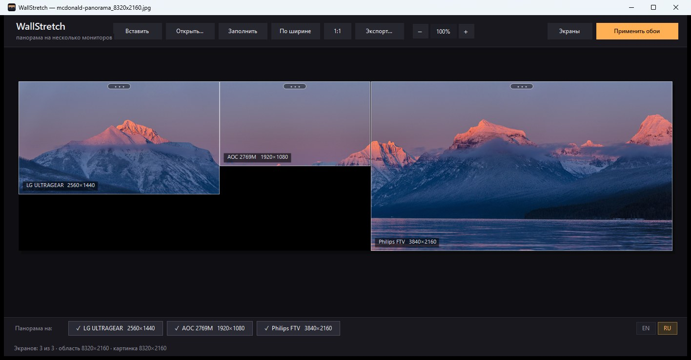

# WallStretch

[English](README.md) · **Русский**

Приложение для Windows: раскладывает одну картинку по нескольким мониторам, показывает, как она
реально ляжет на каждый экран, и ставит обои одним нажатием.

Windows 10/11 · .NET Framework 4.x · MIT



## Возможности

- **Живой предпросмотр** реального рабочего стола: мониторы в настоящих пропорциях и положении.
- **Вставка картинки** из буфера (`Ctrl+V`), открытие файла или перетаскивание в окно.
- **Масштаб**: колесо мыши (вокруг курсора), кнопки `−` / `+`, клик по проценту — вернуть 1:1.
- **Перемещение картинки** мышью или стрелками (`Shift` — по 10 px).
- **Сдвиг монитора по вертикали** — ручка `⋯` сверху экрана, чтобы картинка совпала с реальным
  расположением мониторов. Двойной клик по ручке — сброс.
- **Исключение мониторов** из панорамы: исключённые экраны не трогаются, рабочая область
  сжимается до оставшихся.
- **Обои на каждый монитор отдельно** (`IDesktopWallpaper`): пиксель-в-пиксель, без растягивания,
  работает и при разном масштабе DPI (проверено на 4K-телевизоре с 300 %).
- **Экспорт** картинок по мониторам в папку.
- **Язык интерфейса: английский / русский** (по умолчанию английский) — переключатель `EN` / `RU`
  в правом нижнем углу.
- Выбранные экраны, сдвиги и язык запоминаются между запусками.

## Установка

1. Скачайте `WallStretch-1.x.zip` из [Releases](https://github.com/nikkawaf-rgb/WallStretch/releases) и распакуйте.
2. Запустите `WallStretch.exe`.

Требования: Windows 10/11, .NET Framework 4.x (уже входит в систему).

## Как пользоваться

1. Добавьте картинку (`Ctrl+V`, «Вставить», «Открыть…» или перетащите файл).
2. В центре — ваш рабочий стол: рамки мониторов поверх изображения.
3. Двигайте картинку, масштабируйте колесом, используйте **Заполнить** / **По ширине** / **1:1**.
4. Если экран стоит ниже или выше своей рамки — потяните ручку `⋯` вверх/вниз, пока картинка не совпадёт.
5. Нажмите **Применить обои** — каждый включённый монитор получит свою картинку точно в его разрешении.

## Горячие клавиши

| Клавиши | Действие |
| --- | --- |
| `Ctrl+V` | вставить картинку из буфера |
| `Ctrl+O` | открыть файл |
| `Ctrl+S` | экспортировать картинки по мониторам в папку |
| стрелки | сдвиг картинки на 1 px |
| `Shift` + стрелки | сдвиг на 10 px |
| колесо мыши | масштаб картинки |
| двойной клик по картинке | «Заполнить» |
| двойной клик по ручке монитора | сбросить сдвиг экрана |

## Как это работает

- Для каждого монитора рендерится картинка ровно его размера (например 2560×1440) с нужным куском
  изображения и с учётом вертикального сдвига этого экрана.
- Картинки ставятся через `IDesktopWallpaper.SetWallpaper` — Windows рисует их 1:1 в физических
  пикселях, без растягивания и обрезки.
- Если потянуть экран вниз на 60 px, картинка на нём поднимется ровно на 60 px (проверено скриншотами).

## Командная строка

```
WallStretch.exe --list                          список мониторов
WallStretch.exe --render in.jpg out.jpg         собрать общий кадр без запуска окна
WallStretch.exe --apply in.jpg                  растянуть на весь рабочий стол (Span)
```

## Сборка

```
powershell -ExecutionPolicy Bypass -File build.ps1
```

Компилятор — `csc.exe` из .NET Framework 4.x: без NuGet и внешних зависимостей. Каждый тег `v*`
собирается и публикуется автоматически через GitHub Actions (`.github/workflows/build.yml`).

## Лицензия

MIT — см. [LICENSE](LICENSE).
